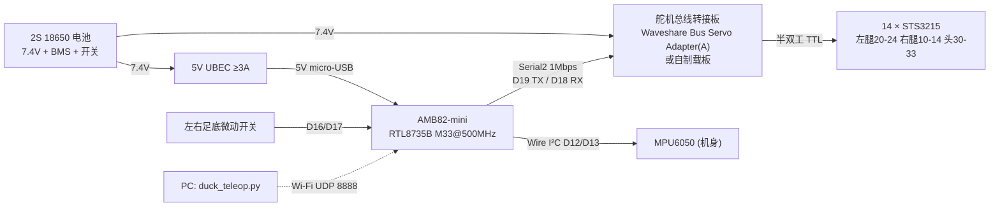
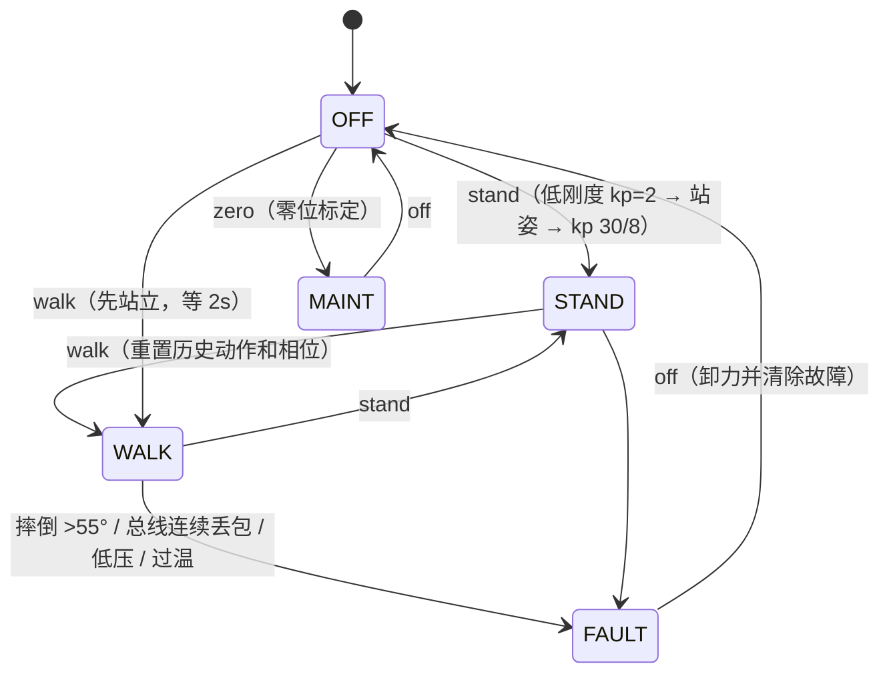

# Ameba Pro2 复刻"英伟达鸭子"——可行性调研与详细设计

> [!summary] 结论先行
> 1. **可行 ✅**。复刻对象选完全开源的 **[[Open Duck Mini]] v2**。英伟达台上那只 **[[Microduck]]** 硬件不开源，舵机 XL330 也在涨价。
> 2. **[[AMB82-mini]]（Ameba Pro2）可以直接替代 Pi Zero 2W 跑官方 RL 行走策略**。算力、内存、舵机总线都有余量（见 §2）。
> 3. **已在 PC 上验证**：
>    - C++ 推理与 onnxruntime 的最大误差 **9.9e-7**。
>    - STS3215 报文与 Pollen 官方 rustypot 的单测向量**逐字节一致**。
>    - 整份固件在 Arduino 桩环境下**编译、启动通过**。
> 4. **还没验证**（要有实物）：
>    - 1 Mbps 总线的实际误码。
>    - 推理在板上的真实耗时。
>    - 用 MPU6050 替代 BNO055 之后的 sim2real 效果。
> 5. **预算**约 **¥2,000–2,600**（不含打印机）。**工期**约 **3–5 个周末**，其中 3D 打印机器时间约 50 小时。
>
> 动手步骤 → [[Ameba鸭子-操作手册]]；代码 → `wiki/008-机器人/ameba_duck/`

---

## 1. "英伟达鸭子"是哪只？三只鸭子对比

| | **Disney BDX** | **[[Microduck]]**（本轮爆火） | **[[Open Duck Mini]] v2**（本方案基线） |
|---|---|---|---|
| 出处 | Disney Research（BDX 论文） | Pollen Robotics / Hugging Face；Jensen Huang 在 **GTC Berlin 2026-10-21** keynote 上演示 | Antoine Pirrone（Pollen）开源项目，HF/Pollen 赞助 |
| 尺寸 / 重量 | 约 0.66 m | 约 25 cm，<800 g | 约 42 cm（腿伸直） |
| 执行器 | 定制 | 15 × **Dynamixel XL330**（Protocol 2.0，1 Mbps） | 14 × **Feetech [[STS3215]]** 7.4V（1 Mbps） |
| 主控 | — | Radxa Zero 3W（RK3566） | Raspberry Pi Zero 2W |
| IMU | — | LSM6DSV16X（身体）+ BMI088（头） | BNO055 |
| 策略 | — | MLP [512,256,128] ELU，61→14，50 Hz（Isaac Lab 3.0 / mjlab） | MLP [512,256,128] SiLU，**101→14**，50 Hz（MuJoCo Playground） |
| 开源范围 | 不开源 | 软件 Apache-2.0；网格 **CC BY-NC-SA**；**CAD 与主板不开源**，官方要求不要称其为开源硬件 | **全开源**：STL、Onshape CAD、BOM、Runtime、训练代码 |
| 价格 | — | $399 预售（2 万+ 预订，交期推到 2027） | BOM 低于 $400 |

**为什么选 Open Duck Mini v2 做基线：**
- **硬件可合法照做。** Microduck 的网格只能非商用，且没有 CAD。
- **舵机便宜、国内好买。** STS3215 约 ¥98/个。XL330 在 Microduck 发布后报价 ¥180–500，还在涨。
- **有现成的策略和 Runtime 可以对拍。**
- **国内已有一条 Microduck 复刻路线**：`fanhao375/microduck-replica`，用飞特 HD-1910 + Radxa Zero 3W，2026-10-24 已实机行走。它仍然依赖 Linux SoC，不在本方案范围内，列作备选。

---

## 2. 可行性逐项分析

### 2.1 算力：策略能在 MCU 上跑吗？✅

ONNX 图结构我拆出来核对过（`BEST_WALK_ONNX_2.onnx`）：

```
obs[101] → (obs-mean)*inv_std → 512 → SiLU → 256 → SiLU → 128 → SiLU → 28 → 取前14维 → tanh → action[14]
```

| 指标 | 数值 |
|---|---|
| 参数量 | 220,262（fp32 860 KiB） |
| 每步乘加 | 约 21.9 万 MAC |
| 控制频率 | 50 Hz，即 20 ms 预算 |
| AMB82-mini CPU | Cortex-M33 @500 MHz，单精度 FPU + DSP（`-mfpu=fpv5-sp-d16`） |
| **推理估算** | **1–5 ms**：每次乘加 2–5 个周期，再加 DDR 访存。⚠ 待实测，固件里的 `bench` 命令会打印实测值 |
| 旁证 | 社区 `esp-duck` 已在 ESP32-S3 上以 INT8 跑通 Microduck 的 50 Hz 策略 |

**结论：** fp32 不量化就够用，用不着 NPU。AMB82 的 NPU 只能跑 Realtek 转换的固定类型模型（YOLO 一类），也不适合这个场景。

### 2.2 内存 ✅（有一个坑）

- **权重放哪：** 链接脚本 `amebapro2_ram_arduino.ld` 把 `.text/.rodata` 放进 **128 MB DDR**，开机时从 flash 载入。所以 `static const float` 权重天然就在 DDR 里，不用拷贝。
- **坑：FreeRTOS 堆只有 120 KB**（`FreeRTOSConfig.h`）。最初版本用 malloc 拷权重，会失败，已改成原地读权重 + 2 × 2 KB 静态缓冲。

### 2.3 舵机总线 ✅（两个坑，已在设计里规避）

- **端口：** `Serial2`，TX = D19（PD_15），RX = D18（PD_16），1 Mbps。SDK 里 `SERIAL_TWO_UART_MODIFIABLE_BAUD_RATE=1`，UART2 时钟 50 MHz。
- **坑 1：`Serial2.flush()` 是空函数。** SDK 源码里只有 `// TODO`，所以无法知道最后一个字节什么时候发完。
  - 这意味着"方向脚切换收发"的方案不可靠。
  - **必须用自动换向电路**：Waveshare Bus Servo Adapter (A)，或照 Feetech 参考电路自制，见 §4.2。
- **坑 2：Serial2 接收环形缓冲只有 128 B**（`RingBuffer.h`），而 14 个舵机一次同步读的应答是 140 B。
  - 驱动里把同步读拆成 7 + 7 两批（`STS_SYNC_READ_CHUNK`）。
- **每周期总线时间：** 共 212 字节，约 2.1 ms，再加舵机应答延时，合计约 3–4 ms。

### 2.4 IMU ⚠ 有替换

- **问题：** BNO055 依赖 I²C clock stretching。社区的 Ameba 移植（`rkuo2000/AmebaPro_OpenDuck`）README 明确写了 *"BNO055 currently not supported by AmebaPro2"*。
- **策略其实只用两样原始量：** gyro（rad/s）和 acc（m/s²）。所以换成 **MPU6050 / GY-521**（约 ¥10）。
  - Ameba SDK 自带 MPU6050 库和示例。
  - 开机时做陀螺零偏标定，再把轴向映射到机身坐标系。
- **风险：** 策略是用 BNO055 的数据训练的，换 IMU 后噪声和滤波特性会不同。训练时已经加了这些随机化，有一定鲁棒性：
  - gyro ±0.1 rad/s、acc ±0.05 m/s²；
  - 0–3 步的 IMU 延迟。
- **退路：**
  - 换 BMI270（SDK 自带 SparkFun 库）。
  - BNO055 改用 UART 模式，接 Serial1 = D21/D22。
  - 用 MPU6050 的噪声模型重训策略（§5）。

### 2.5 遥控 ⚠ 有替换

- Ameba 没有 BLE HID **主机**，所以官方方案里的 Xbox 手柄连不上。
- 改为 **Wi-Fi UDP**：PC 上跑 `tools/duck_teleop.py`，键盘 WASD 或 USB 手柄都能用。

### 2.6 50 Hz 时序预算

| 阶段 | 估算 |
|---|---|
| IMU 读 14 字节（I²C 400 kHz） | 约 0.4 ms |
| 同步读 14 路位置+速度（2 批） | 约 2–3 ms |
| MLP 推理 | 约 1–5 ms ⚠ |
| 同步写 14 路目标角 | 约 0.5 ms |
| **合计** | **约 4–9 ms，低于 20 ms** ✅ |

### 2.7 风险清单（前 5 项）

| # | 风险 | 概率 | 对策 |
|---|---|---|---|
| 1 | 换成 MPU6050 后 sim2real 变差，走不稳 | 中 | 先确认轴向和符号无误；调 kp；不行就用新 IMU 的噪声模型重训 |
| 2 | 1 Mbps 误码或应答丢包 | 低–中 | `stat` 看 `bus_miss`；舵机降到 500 kbps（寄存器 6 = 1）；缩短总线线长 |
| 3 | 舵机寄存器 85（最大加速度）出厂为 50，比仿真慢约 3 倍，机器人后仰摔倒 | 高（社区实测） | 固件 `cfg` 命令统一写 0 |
| 4 | 站立时腿以约 5 Hz 抖动 | 中（社区实测） | 腿 kp 从 30 降到 20（运行 `kp 20 8`） |
| 5 | 3D 打印件太脆，或公差装不上 | 中 | 先试打一只脚；受力件改用 PETG；鞋底用 TPU |

---

## 3. 系统架构



**固件线程模型：**

- **控制线程**（`os_thread_create_arduino`，`osPriorityHigh`，50 Hz）：
  `IMU → 同步读舵机 → 拼 101 维观测 → MLP → 目标角 → 同步写`，同时做摔倒、掉线、低压、过温保护。
- **`loop()`**：USB 串口命令行和 UDP 遥控用同一套命令；舵机配置和标定向导也在这里。即使 UDP 读数阻塞，也不会影响控制线程。



---

## 4. 详细设计

### 4.1 物料清单（BOM，第一阶段：不画 PCB）

| 物料 | 数量 | 参考单价 | 小计 | 备注 |
|---|---|---|---|---|
| Feetech **STS3215 7.4V**（C001，1:345） | 14 | ¥98 | ¥1,372 | 不要用 12V 版：策略的电机模型是 7.4V 版辨识出来的 |
| **AMB82-mini** | 1 | 约 ¥180（估） | ¥180 | 国内渠道少，可走瑞昱代理或台湾店铺 |
| Waveshare **Bus Servo Adapter (A)** | 1 | ¥27 | ¥27 | 跳线帽设到 UART 输入 |
| GY-521（MPU6050） | 1 | 约 ¥10（估） | ¥10 | 替代 BNO055 |
| 18650 高倍率电芯（如 Molicel P30B） | 2 | 约 ¥30（估） | ¥60 | 两节先充到同一电压再装 |
| 2S 电池盒 + 2S BMS + USB-C 2S 充电板 + 拨动开关 | 1 套 | — | 约 ¥50（估） | 参照原版 wiring 图 |
| 5V UBEC（≥3A） | 1 | 约 ¥20（估） | ¥20 | 输出接一根 micro-USB 线，给 AMB82 供电 |
| 微动开关（足底） | 2 | — | ¥5 | 原版方案 |
| M3 热熔铜螺母、M3/M2.5 螺丝、轴承、Loctite 243 | 若干 | — | 约 ¥100（估） | 轴承规格、螺丝数量看官方 BOM 表 |
| 线材：5264-3P 舵机线、杜邦线、XT30 | 若干 | — | 约 ¥30 | |
| PLA 约 1 kg + TPU 约 0.1 kg | — | — | 约 ¥100 | 也可找代打服务，约 ¥150–300 |
| 调试支架：20 mm PVC 管约 2 m + 绑带 | — | — | 约 ¥15 | 配 §4.3 的打印接头 |
| **合计** | | | **约 ¥2,000–2,600** | 社区纯自购估价 ¥2,500–3,000 |

官方 BOM 表：Google Sheet，另有中文飞书版，链接在 Open_Duck_Mini 的 README。价格来源：STS3215 ¥97.72 取自 SO-ARM100 淘宝 BOM，Feetech 首发价 ¥99；Waveshare 转接板 ¥27。标"估"的都是估算价。

### 4.2 电气与 PCB

#### 4.2.1 第一阶段接线（模块化，不画板）

| AMB82-mini 引脚 | 接到 | 说明 |
|---|---|---|
| **D19**（Serial2 TX） | 转接板 UART TX | Waveshare 官方示例写的是"RX-RX、TX-TX"（丝印按主控视角标注）。如果不通，对调 TX/RX 再试一次，不会损坏 |
| **D18**（Serial2 RX） | 转接板 UART RX | |
| GND | 转接板 GND | **必须共地** |
| **D12**（SDA）/ **D13**（SCL） | GY-521 SDA / SCL | `Wire`，400 kHz |
| — | GY-521 VCC ← UBEC 5V | GY-521 自带 3.3V LDO。上电后先用万用表量 SDA 空闲电压，**必须 ≤3.6V** 才能接 AMB82（AMB82 的 IO 不耐 5V） |
| **D16** / **D17** | 左 / 右足底开关（另一端接 GND） | 内部上拉；按下 = 着地 = 1 |
| D20 | 暂停按键（另一端接 GND，可选） | |
| micro-USB | UBEC 5V | V_USB 引脚能否反向供电，官方论坛说法矛盾，所以统一走 micro-USB |
| 转接板 DC 输入 | 电池 7.4V（经开关和 BMS） | 舵机供电**不经过** AMB82 |

**引脚出处：** 全部核对自官方 SDK 的 `variants/ameba_amb82-mini/variant.h`。

**要避开的引脚：**
- D25/D26：USB 日志串口。
- D27/D28：SWD 调试口。
- D14/D15：SPI0/Serial3，与 Wire 所在的 SPI0 组冲突。

#### 4.2.2 第二阶段：自制 Ameba Duck Carrier 载板（详设）

**规格：**
- 2 层板，50 × 70 mm，4 个 M3 安装孔，孔距 43 × 63 mm，与 §4.3 的托架配套。
- 也可以直接用 50 × 70 洞洞板手焊同样的电路。

**半双工自动换向电路**（Feetech / Waveshare 参考电路。`HeyPCB/quack-core` 的原理图里有同一电路，我逐个器件核对过）：

```
3V3 ─R12 10k─┬─ D19 (TXD)
             ├──────────────► U2 74LVC1G126  A(2)   Y(4) ──┬──► SERVO_DATA ──► 3 × 5264-3P（左腿 / 右腿 / 头颈）
             │                OE(1) = TXEN                 │
             └─R13 10k─► Q6 MMBT3906 基极                    ├─ R15 10k → 3V3（可选上拉）
                         发射极 = 3V3, 集电极 = TXEN          │
                         TXEN ─R14 20k─ GND                  └──► U3 74LVC1G125 A(2), /OE(1) = TXEN, Y(4) ──┬──► D18 (RXD)
                                                                                                         └─ R16 10k → 3V3
U2/U3 VCC = 3V3，各配 100 nF 去耦
```

**工作原理：**
1. **TXD 为低**（起始位或 0 位）→ PNP 导通 → TXEN = 1。
   - U2 把总线拉低。
   - U3 关闭，RXD 被上拉保持高，所以**不会回显**自己发出的数据。
2. **TXD 为高**（空闲位或 1 位）→ PNP 截止 → TXEN 被下拉。
   - U2 进入高阻。截止有一段存储时间，U2 在上升沿会短暂主动推高，帮总线快速回到高电平。
   - U3 打开，MCU 就能收到舵机的应答。
3. **结果：** 不需要方向脚，也不受 `flush()` 是空函数的影响。全部是 3.3V 逻辑，可以直接接 AMB82。

**载板网表**（其余用通用 0603 阻容）：

| 网络 | 连接 |
|---|---|
| VBAT_IN | XT30 母座 → 15 A 保险 → VSERVO |
| VSERVO | 3 × 5264-3P 的中间脚 + 2 × 470 µF/16V 电解电容（靠近接口放） |
| SERVO_DATA | U2.Y、U3.A、3 × 5264-3P 的 DATA 脚，每个接口加 ESD 管（如 ESD5Z5.0） |
| TXD / RXD | AMB82 D19 / D18（经排母） |
| I²C | D12/D13 → 4P 排针（接 GY-521）；4.7k 上拉到 3V3（可不焊） |
| FOOT_L / FOOT_R | D16 / D17 ← JST-PH 2P；1k 串联 + 100 nF 对地（RC 去抖），外加 ESD |
| VBAT_SENSE | VBAT → 100k → A0(D11) → 47k → GND，并 100 nF（8.4V 对应 2.69V） |
| 5V | UBEC 输入 2P 排针 → micro-USB 供电线焊盘；V_USB 跳线默认**不焊**，实测确认后再用 |
| 3V3 | 取自 AMB82 的 VDD33 引脚，只给 U2/U3/上拉/IMU 这些逻辑器件用 |

**关键器件**（料号核对自 quack-core 的 JLC BOM）：

| 位号 | 器件 | 立创编号 |
|---|---|---|
| U2 | SN74LVC1G126DBVR | C7834 |
| U3 | SN74LVC1G125DBVR | C23654 |
| Q6 | MMBT3906LT1G | C53444 |
| J 舵机 | HC-5264-3A | C2845815 |

**布板规则：**
- **VSERVO / GND 走线 ≥3 mm**，或铺铜加 2 oz。电流估算：行走时 14 个舵机合计 3–6 A；单个 STS3215 堵转 2.5 A。
- 电解电容紧贴舵机接口放。
- 逻辑地和舵机地**单点汇合**，汇合点放在 XT30 附近。
- D19/D18 到 U2/U3 的走线 <15 mm。
- ⚠ **AMB82-mini 两排排母的行距按实物用卡尺量后再下单。** 官方 Fritzing 图外形约 37.8 × 61.9 mm，两排各 15 针，行距推算约 35.6 mm（1.4"），**没有核实**。

### 4.3 3D 打印与结构

#### 原版 36 种、共 51 个零件

- 来源：`Open_Duck_Mini/print/`，Apache-2.0。
- 材料：
  - PLA，15% 填充，0.2 mm 层高。
  - `foot_bottom_tpu.stl` 用 TPU，40% 填充。
  - 受力件（大腿、小腿连接片）可以改用 PETG。
- **打印平台至少 220 × 220 mm**：最大件 `head.stl` 为 199.8 × 197.3 mm，`head_bot_sheet.stl` 为 193.8 × 191.6 mm。
- **用料：** 实心体积换算约 PLA 2.0 kg + TPU 57 g，这是上限。社区按 15% 填充实际计划约 **990 g PLA + 34 g TPU**。
- **机时：** 约 50 小时。MakerWorld 上有一份 6 盘方案标 52.8 h（未核实）。

#### 本方案新增的打印件

由 `ameba_duck/cad/gen_parts.py` 参数化生成，已生成 STL，均为水密网格。

| 文件 | 尺寸 | 用途 |
|---|---|---|
| `amb82_tray.stl` ×1 | 56 × 76 × 7.5 mm | 主控托架。底部 4 孔对齐原版 Pi Zero 2W 的 58 × 23 mm M2.5 孔，**直接装在头部原 Pi 的位置**；上部 50 × 70 mm 定位槽 + 4 个 M3 自攻柱，放洞洞板或载板 |
| `stand_foot_tee.stl` ×2 | 50 × 27 × 58 mm | 调试支架底座 T 接头（套 20 mm PVC 管） |
| `stand_top_elbow.stl` ×2 | 59 × 27 × 59 mm | 调试支架顶部弯头 |

**调试支架**用 PVC 管搭成"门"字形，在横梁中间用绑带吊住鸭子身体，让脚离地。零位标定和第一次跑策略都要吊着做，腿乱踢也不会摔。

**布局：**
- AMB82 + 载板放在头部原 Pi 的位置。头部空间约 200 mm 见方，足够；摄像头 FPC 也近。
- 舵机转接板放在身体原"motor control board"的位置。
- MPU6050 贴在机身原 BNO055 的位置。仿真里 IMU site 在机身坐标 (-0.08, 0, 0.05) m，要和机身轴向对齐。
- 如果头部空间干涉，把主控移进 `body_back` 后舱（quack-core 的方案 A 就是这么做的）。

### 4.4 固件设计

**代码位置：** `wiki/008-机器人/ameba_duck/`

| 文件 | 职责 |
|---|---|
| `firmware/ameba_duck/ameba_duck.ino` | 主程序：控制线程、状态机、命令行、UDP、标定向导、保护 |
| `firmware/ameba_duck/duck_config.h` | 引脚、舵机 ID、站姿、**零位偏移 ⚠**、kp、训练参数、IMU 轴向、安全阈值、Wi-Fi |
| `firmware/ameba_duck/sts_bus.h/.cpp` | STS3215 协议：ping / read / write / sync_read / sync_write，带掉线容错和分批读 |
| `firmware/ameba_duck/duck_policy.h/.cpp` | MLP 推理（纯 C++，无依赖）+ 开机自检 |
| `firmware/ameba_duck/imu_mpu6050.h/.cpp` | MPU6050 寄存器级驱动：±500 dps、±4 g、DLPF 44 Hz，零偏标定，轴向映射 |
| `tools/export_policy.py` | ONNX → `policy_weights.h` + `policy_selftest.h`，导出前先与 onnxruntime 对拍 |
| `tools/run_host_tests.sh` | PC 一键自测：导出 → 推理对拍 → 舵机协议单测 |
| `tools/test_sts_host.cpp` | 虚拟 STS3215 总线：报文向量、单位换算、端到端读写、掉线容错 |
| `tools/duck_teleop.py` | Wi-Fi 遥控界面（键盘/手柄） |
| `cad/gen_parts.py` | 新增打印件生成器 |

#### 101 维观测布局

与 Runtime 的 `v2_rl_walk_mujoco.py` 中 `get_obs()` 逐项对齐：

| 下标 | 维数 | 内容 | 单位 / 处理 |
|---|---|---|---|
| 0–2 | 3 | gyro | rad/s，机身系：x 前、y 左、z 上 |
| 3–5 | 3 | accelerometer | m/s²，静止直立时约 (0, 0, +9.8) |
| 6–12 | 7 | 指令 | vx, vy, wz, neck_pitch, head_pitch, head_yaw, head_roll |
| 13–26 | 14 | 关节位置 − 默认站姿 | rad，保留 3 位小数 |
| 27–40 | 14 | 关节速度 × 0.05 | rad/s |
| 41–54 | 14 | 上一帧 action | |
| 55–68 | 14 | 上上帧 action | |
| 69–82 | 14 | 上上上帧 action | |
| 83–96 | 14 | 当前 motor_targets | 含头部指令叠加 |
| 97–98 | 2 | 左 / 右足底接触 | 0/1 |
| 99–100 | 2 | 步态相位 (cos, sin) | 周期 27 步 = 0.54 s × 50 fps；**取完观测后**再推进相位 |

**关节顺序与舵机 ID**（不能改）：

`left_hip_yaw 20, left_hip_roll 21, left_hip_pitch 22, left_knee 23, left_ankle 24, neck_pitch 30, head_pitch 31, head_yaw 32, head_roll 33, right_hip_yaw 10, right_hip_roll 11, right_hip_pitch 12, right_knee 13, right_ankle 14`

**动作到舵机：**
- `target = INIT_POS + action × 0.25`
- 头部 4 个关节再加上指令：`target[5..8] += cmd[3..6]`
- 写入舵机的值 = `target + offset`
- 弧度和步数的换算：`raw = 4096·(π+rad)/2π`，2048 步 = 0 rad

**保护：**

| 条件 | 动作 |
|---|---|
| 倾角 >55° 持续 5 个周期 | 全部卸力 |
| 总线连续 10 个周期丢包 | 全部卸力 |
| 电压 <6.6 V | 停机 |
| 任一舵机 ≥65 ℃ | 停机 |
| 遥控指令 0.5 s 没有更新 | 速度清零（原地踏步） |
| 策略自检误差 >1e-3 | 禁止 walk |

### 4.5 验证状态

| 项目 | 状态 | 证据 |
|---|---|---|
| ONNX 结构解析 + numpy 复现 | ✅ | 64 组随机输入，最大误差 1.25e-6 |
| C++ 推理 vs onnxruntime | ✅ | 8 组向量，最大误差 9.9e-7（也作为固件开机自检） |
| STS 报文格式 | ✅ | sync_read / sync_write 与 rustypot `v1.rs` 单测向量逐字节一致 |
| 总线端到端（虚拟舵机） | ✅ | 14 路写后读回误差 ≤0.0015 rad；单个舵机掉线时其余 13 路照常读到 |
| 单测发现的 bug | ✅ 已修 | 同步读时中间一个舵机掉线，会把后一个也连坐丢掉 → 改为按应答 ID 归位 |
| 固件整体编译 | ✅（桩环境） | 用 g++ 加 Arduino 桩头文件编译并跑 `setup()`。**还没有用 Ameba 官方工具链编译** |
| 板上推理耗时 / 1 Mbps 实测 / 行走 | ⏳ 待实物 | 用固件命令 `bench`、`stat` |

---

## 5. 后续路线

1. **重训策略**（`Open_Duck_Playground`，默认 1.5 亿步，耗时看 GPU；Pollen 的 Microduck mjlab 方案在 4096 个并行环境下约 1–2 小时出可用步态，可作参考）：
   - 把 MPU6050 的噪声和延迟写进噪声配置。
   - 按社区实测，把力矩上限改成真实堵转值 1.86 N·m，原来是 3.23 N·m。社区实测重训后速度翻倍以上。
2. **视觉：** AMB82 有 ISP + NPU，可以跑 YOLO 做人跟随，或者开 RTSP 图传。
3. **表情功能：**
   - 眼睛 LED、天线舵机（PWM 引脚 D1–D8）。
   - I²S 喇叭：AMB82 自带音频 codec。
4. **INT8 量化：** 权重压到 220 KB，可以放进片上 SRAM 提速。
5. **Microduck 尺寸版：** 参考 `fanhao375/microduck-replica` 的结构，换成 HD-1910 舵机，再按新机型重训。

## 相关

[[Ameba鸭子-操作手册]] · [[Open Duck Mini]] · [[Microduck]] · [[STS3215]] · [[AMB82-mini]]
